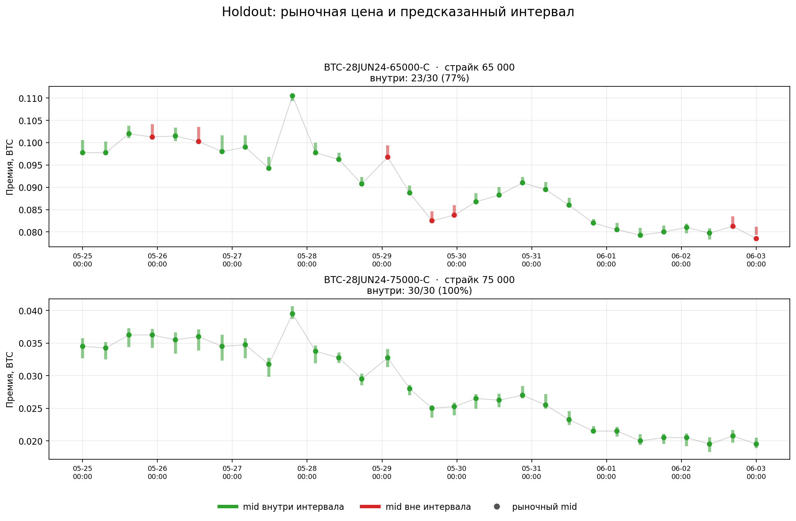
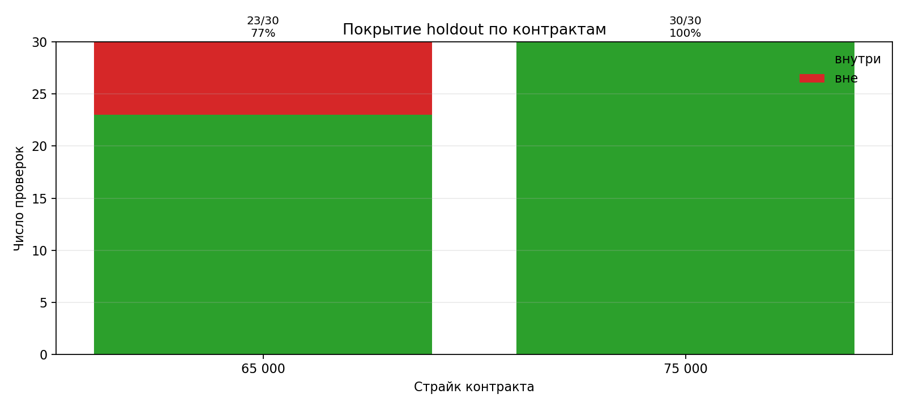
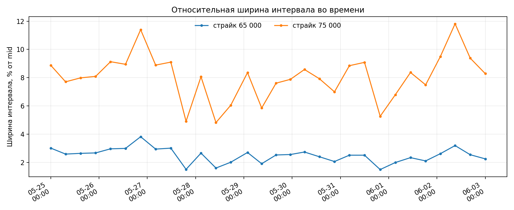

# Пилот: IV-интервалы для BTC call

- Снимков: 30
- Строк котировок: 342
- Успешных IV: 342
- Holdout-контрактов: 2
- Проверок holdout: 60
- Coverage holdout: 0.8833333333333333
- Средняя ширина holdout: 0.002277779835951447 BTC
- Средняя относительная ширина: 0.05282921853433834

## Block trades

- Сделок в файле: 11
- Проверок block trades: 0
- Coverage block trades: None
- Средняя ширина block: None BTC

## Графики

### Рыночная цена и предсказанный интервал

### Покрытие по контрактам

### Относительная ширина интервала

